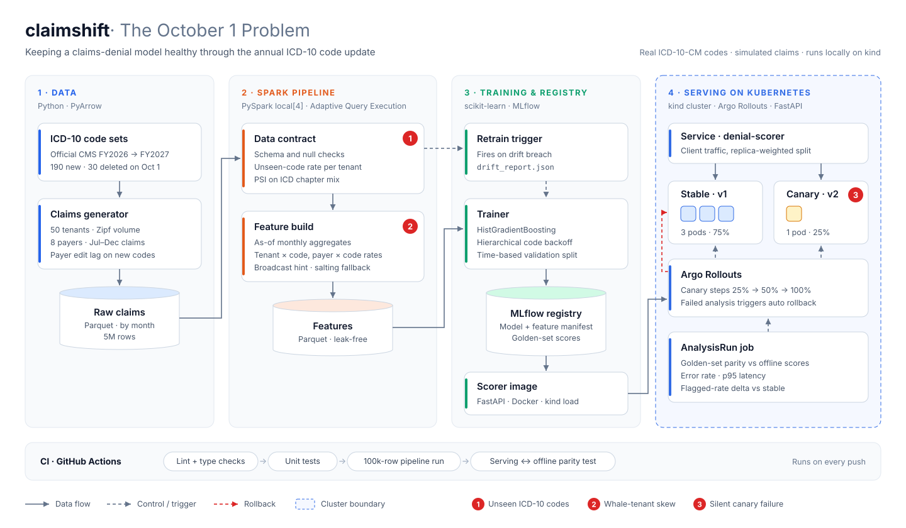

# claimshift

### The October 1 Problem

**Keeping a claims-denial model healthy through the annual ICD-10 code update: drift detection, Spark skew, and a canary rollout that catches a silent failure.**

> Every October 1, the U.S. healthcare system switches to a new ICD-10 code set. Claims submitted the next morning carry diagnosis codes that a production model has never seen. Nothing crashes. The model just quietly gets worse.

This repo simulates that day end to end on a laptop and works through the three incidents that follow it. Each incident has a written postmortem in `docs/incidents/`, and every number in this README comes from an actual run.

---

## What this demonstrates

| # | Incident | Where it happens | How it's detected | Fix |
|---|---|---|---|---|
| 1 | **Unseen codes after Oct 1.** The model maps new codes to "unknown" and scores degrade silently. | Data / model | Data contract in the Spark pipeline: unseen-code rate per tenant, PSI on ICD chapter mix | Hierarchical backoff (code → category → chapter), then a retrain triggered by the drift alert |
| 2 | **Retraining stalls on skew.** Three "whale" health systems hold most of the claim volume, so one Spark task runs far longer than the rest. | Distributed data pipeline | Spark event log: rows and run time per task in the join stage | Broadcast the small side (hint); salting when it's too big to broadcast. AQE alone did **not** fix it |
| 3 | **Silent canary failure.** The retrained v2 server builds its feature vector in the wrong column order. No errors, normal latency, wrong scores. | Kubernetes serving | Canary analysis job: online-vs-offline score parity on a golden set, plus error and latency guardrails | Automatic rollback by Argo Rollouts; serving now validates features by name against the model's manifest |

---

## Architecture



### Components

| Layer | What it does | Tech |
|---|---|---|
| Data generator | **Real ICD-10-CM codes** from the CMS FY2026 and FY2027 files, including the actual Oct 1 changes (190 new, 30 deleted). 50 tenants with Zipf-distributed volume (top 3 ≈ 57% of claims), including two women's-and-children's tenants where the obstetric changes land; 8 payers; Jul–Dec claims. Denial labels come from payer rules, including **payer edit lag**: payers deny more of the new codes in October. | Python, PyArrow |
| Data contract | Checks schema and nulls, unseen-code rate per tenant, and PSI on ICD chapter distribution. Writes `drift_report.json`; a breach triggers a retrain. | PySpark |
| Feature build | Claim-level features; code denial rates smoothed up the ICD hierarchy (code → category → chapter, the incident 1 fix); payer and payer×code rates; a tenant profile. Everything is computed **as of the month start** from labels already received, so training never sees the future. The tenant join is where incident 2 lives. | PySpark |
| Training | Gradient-boosted classifier. Every model ships with a **feature manifest** (ordered names and types) and **golden-set scores** (offline predictions on 2,000 fixed claims). | scikit-learn `HistGradientBoostingClassifier`, MLflow |
| Serving | `/predict`, `/health`, `/metrics`. The readiness probe waits for the model to load. | FastAPI, Docker |
| Rollout | Canary at 25% → 50% → 100%, with an analysis step before each increase. Replica-based weights (4 replicas) keep it light on a laptop. | kind, Argo Rollouts |
| Canary analysis | A Kubernetes Job replays the golden set against the canary and compares the results to the offline scores (**parity**), then checks error rate, p95 latency, and the flagged-rate delta against stable. A non-zero exit means Argo aborts and rolls back. | Python, Kubernetes Job |

### Why a golden-set parity check?

A retrained model *should* score differently from the old one, so comparing canary to stable alone can't tell an improvement from a bug. Comparing the canary's **online** scores to the **same model's offline** scores on fixed inputs isolates training/serving skew exactly. It is also deterministic, so it works even when canary traffic is too low for statistical tests.

---

## Starting thresholds (`configs/thresholds.yaml`)

| Check | Warn | Fail |
|---|---|---|
| Unseen-code rate (any tenant with ≥ 500 claims) | > 0.5% | > 2% |
| Invalid code for the service date | — | > 0 |
| PSI, ICD chapter mix | > 0.10 | > 0.25 |
| Canary parity, max \|online − offline\| | — | > 1e-6 |
| Canary error rate | — | > 1% |
| Canary p95 latency | — | > 50 ms (local) |
| Flagged-rate delta vs stable | > 3 pts | > 8 pts |

---

## Results

*Filled in from actual runs. Hardware: MacBook Air, Docker limited to 6–8 GB, Spark `local[4]`.*

**Incident 1: unseen codes**

Detection (data contract, 5M rows; `data/reports/drift_report_YYYY-MM.json`):

| Eval month | Unseen-code rate | Worst tenants | Chapter PSI | Action |
|---|---|---|---|---|
| 2026-09 (train Jul–Aug) | 0.00% overall | 0/50 over limit | 0.0000 | proceed |
| 2026-10 (train Jul–Sep) | 6.14% overall | T04 11.1%, T11 11.1% (OB-heavy) | 0.0000 | **retrain** |

The chapter PSI stays flat because the new codes stay in the same chapters. A coarse distribution check misses this drift, and only the code-level check catches it. The top unseen codes are the new FY2027 ectopic pregnancy codes (O00.512, O00.31, O00.131).


| Model | AUC Jul–Sep | AUC Oct–Nov | Unseen-code rate (Oct) |
|---|---|---|---|
| v1 (no backoff) | _tbd_ | _tbd_ | _tbd_ |
| v1 + hierarchical backoff | _tbd_ | _tbd_ | _tbd_ |
| v2 (retrained) | _tbd_ | _tbd_ | _tbd_ |

**Incident 2: Spark skew** (5M rows)

Same October feature build, five ways (`make skew-bench`, median of 3 runs; `docs/results/skew_bench.json`). The join stage is the one where October's 842k claims meet the tenant profile.

| Run | Tenant join | Tasks | Biggest task (rows) | Max / median task ms | Wall s |
|---|---|---|---|---|---|
| Baseline (AQE off) | Sort-merge | 16 | **290,320 (34.5%)** — tenant T01 | 140 / 21 | 1.74 |
| AQE on (Spark default) | Sort-merge | 5 | **290,320 (34.5%)** — unchanged | 141 / 124 | 1.33 |
| AQE, skew split tuned for laptop | Sort-merge | 12 | **290,320 (34.5%)** — not split | 138 / 33 | 1.58 |
| **Broadcast hint** | Broadcast | 4 | no shuffle; tasks = file splits | 221 / 185 | **1.21 (−30%)** |
| **Salting, 16 buckets** | Sort-merge | 16 | **102,330 (12.1%)** | 77 / 33 | 1.51 (−13%) |

What the event log showed:
- **One task processed 34.5% of October's rows** and ran 6.7× longer than the median task (140 ms vs 21 ms): the whale tenant T01 hashed to a single partition.
- **AQE didn't fix it.** It merged the small partitions (16 → 5), which made max/median ratios look better while the straggler stayed the same size. It couldn't broadcast, because the partially aggregated tenant table was 13 MB, over the 10 MB limit. And it couldn't split the skewed partition, because an aggregate sits between the shuffle and the join; AQE's skew split needs both sides to be raw shuffles.
- **Fix:** broadcast the tenant profile explicitly (now the default in `features.py`). When the small side is too big to broadcast, salting cuts the straggler from 290k to 102k rows (2.8×) and its run time from 140 to 77 ms. A test proves all three join strategies produce identical features.
- At 5M rows the wall-time gains are modest (13–30%) and noisy. The straggler share is the stable signal, and it grows with data.

**Incident 3: silent canary**

| Rollout | Parity max diff | Analysis result | Time to rollback |
|---|---|---|---|
| v2-bad (feature order bug) | _tbd_ | _tbd_ | _tbd_ |
| v2.1 (manifest validation) | _tbd_ | _tbd_ | — |

---

## Run it locally

**Prerequisites (macOS):** Docker Desktop, Python 3.11+, Java 17 (`brew install openjdk@17`), `brew install kind kubectl argoproj/tap/kubectl-argo-rollouts`

```bash
make setup          # venv + dependencies
make data           # generate claims (ROWS=5000000; use ROWS=500000 for a quick run)
make contract-demo  # data contract: Sep passes, Oct triggers a retrain
make features       # as-of features for Aug–Dec -> data/features/
make skew-bench     # incident 2: baseline vs AQE vs broadcast vs salting
make train          # trains a model, logs it to MLflow with manifest + golden scores
make cluster        # creates the kind cluster and installs Argo Rollouts
make deploy-v1      # stable baseline
make rollout-v2-bad # incident 3: watch it roll back
make rollout-v2.1   # fixed version promotes to 100%
make clean
```

Watch a rollout: `kubectl argo rollouts get rollout denial-scorer --watch`

---

## Repo layout

```
claimshift/
├── configs/            thresholds.yaml, spark.yaml
├── reference/cms/      official ICD-10-CM code files, FY2026 and FY2027
├── data_gen/           generate_claims.py, code_sets.py
├── pipeline/           contracts.py, features.py, skew_bench.py, run_pipeline.py
├── training/           train.py, golden_set.py
├── serving/            app.py, features.py, Dockerfile
├── k8s/                kind-config.yaml, services.yaml
├── rollout/            rollout.yaml, analysis-template.yaml, canary_check.py
├── docs/results/       benchmark outputs committed as evidence (skew_bench.json)
├── docs/incidents/     INC-01-unseen-codes.md, INC-02-spark-skew.md, INC-03-silent-canary.md
├── tests/              unit tests + serving/offline parity test
├── .github/workflows/  ci.yml (lint, tests, 100k-row pipeline run, parity test)
└── Makefile
```

---

## Local → production mapping

| Here | Production equivalent |
|---|---|
| PySpark `local[4]` | Spark on EMR or Databricks |
| Parquet on disk | S3 with Iceberg or Delta tables |
| Makefile | Airflow or Step Functions |
| MLflow file store | MLflow tracking server or SageMaker Model Registry |
| kind, single node | EKS, multi-AZ |
| Argo Rollouts, replica weights | Argo Rollouts with ALB or service-mesh weighted routing |
| Analysis Job | Same, plus Prometheus or CloudWatch metrics and alarms |

## What changes at 100× scale

- **Skew gets worse, not better.** Whale tenants grow faster than the long tail. Check the physical plan, not just the AQE setting: AQE can merge partitions without fixing a straggler. Salting factors need tuning per job, not once.
- **Drift checks become a fan-out.** Per-tenant contracts across hundreds of tenants should run as one grouped Spark job, not one job per tenant.
- **The canary needs traffic shaping.** Replica-based weights are coarse; real routing needs ALB or mesh weights. The golden-set parity check still works unchanged.
- **Model load time matters.** Readiness probes, a PodDisruptionBudget, and a HorizontalPodAutoscaler on RPS keep rollouts from dropping capacity.

## Limitations

- ICD-10-CM codes and the Oct 1 changes are the official CMS FY2026/FY2027 files. Claims, volumes and denials are simulated (real claims are PHI), and codes touched by the update are oversampled so the effect is visible at laptop scale.
- A single-node cluster can't show node failures or network partitions.
- Timings come from a laptop and show relative improvement, not production throughput.


